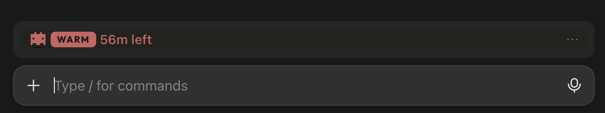

# mini-ribbon

A cache-first fork of [robonuggets/ribbon](https://github.com/robonuggets/ribbon), a Claude Code mod.

It shows one slim row above the prompt with the state of your prompt cache:

<p align="center">
  
</p>

- **WARM** (red, the robot bobs) with the **minutes left** before it goes cold.
- **COLD** (blue, the robot is frozen) with how long you've been idle and what the next message costs to re-cache.

Everything else sits behind one dim **⋯** link at the end of the row, folded by default: usage left in the 7-day and 5-hour windows, and the cache card (idle time, cached tokens, the next message's price on each model). **×** folds them again. It is a link rather than a button so the row stays one text line tall.

In a terminal, the band shows only the cache line as plain text, with no link.

## How it differs from ribbon

| | ribbon | mini-ribbon |
|---|---|---|
| Usage bars | always shown | behind **⋯**, folded |
| Cache card | Show/Hide button; opens on its own when cold | behind the same **⋯**, folded |
| Row height | a button and a 26 px robot | one text line, a 20 px robot |

## Install

```
claude plugin install mini-ribbon --marketplace tbergmen/mini-ribbon
```

Start a new session to see the band. If you have ribbon installed, uninstall it first (`claude plugin uninstall ribbon`) so you don't get two bands.

## Good to know

- **It costs nothing to run.** It reads the app's own numbers and draws them. It never calls a model.
- **Prices are estimates.** They come from the price table in `hooks/cache-art.ts` (`MODELS`), not from your bill.
- **Subagents don't count.** Only your main chat resets the cache clock.

## Remove it

```
claude plugin uninstall mini-ribbon
```

## Develop it

```
claude --plugin-dir ./mini-ribbon
claude plugin test ./mini-ribbon
```

## License

[MIT](LICENSE). The original ribbon is by Jay E from RoboLabs ([RoboNuggets](https://robonuggets.com)).

The embedded font is [Outfit](https://github.com/Outfitio/Outfit-Fonts), under the SIL Open Font License 1.1.
